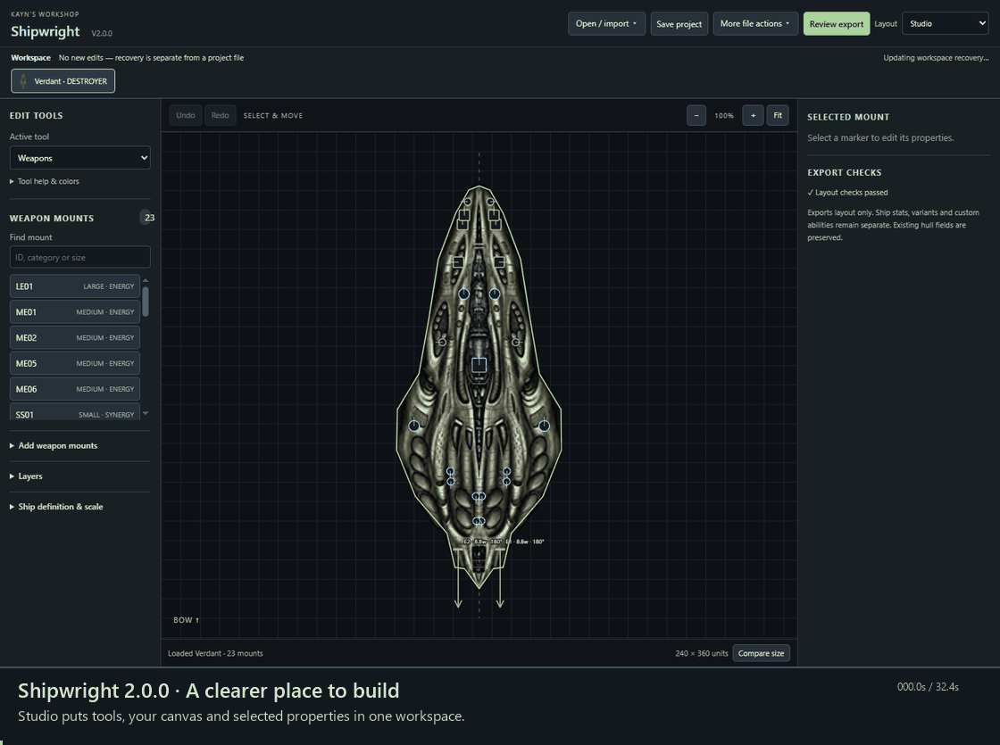
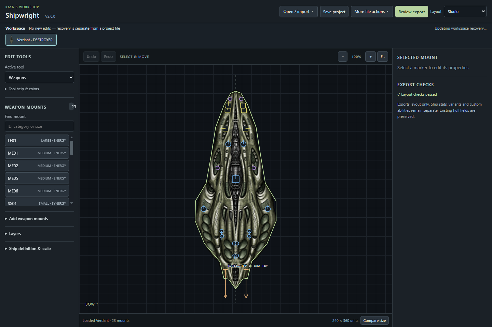
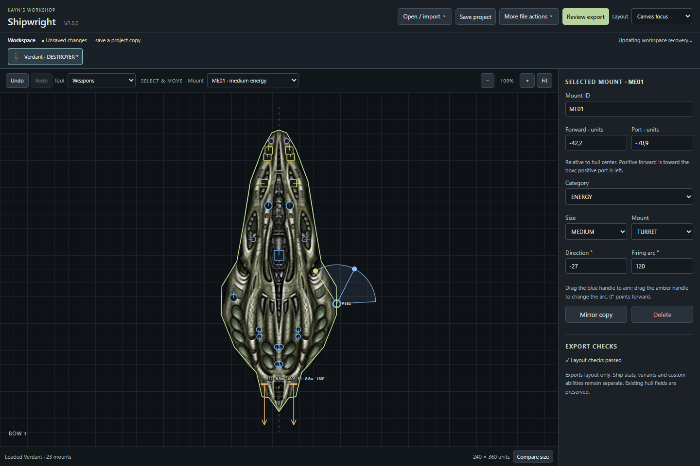
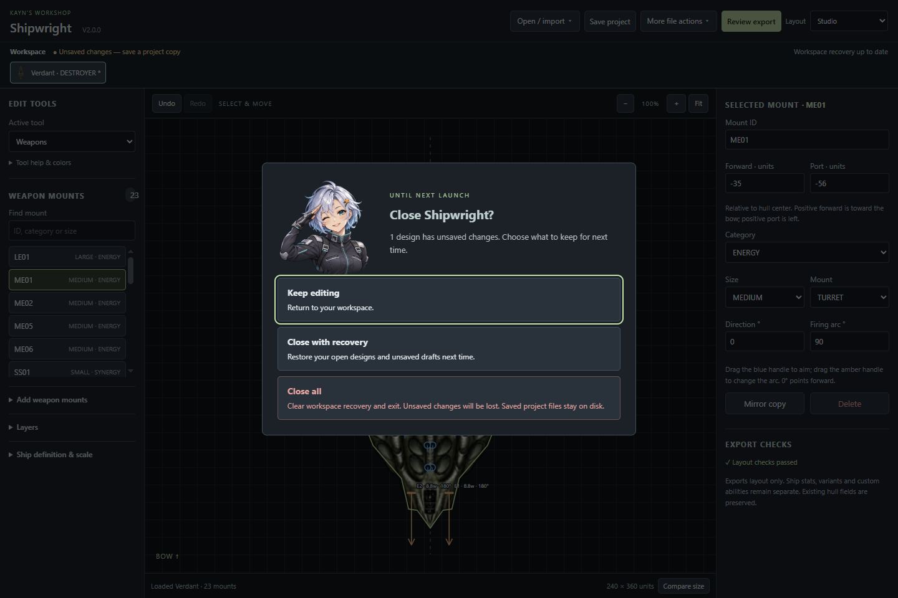

<div align="center">

# Kayn Shipwright

**Build the layout. Keep your place. Review the export.**

Offline Starsector hull-layout editor · Windows x64 · **2.0.0**

[Download the latest release](https://github.com/MysticEntry-Nova64/KaynShipwright/releases/latest) · [Quick start](#start-building) · [Code map](docs/code-map.md) · [Release history](docs/releases.md)

</div>



Actual packaged-app demonstration · 32.4 seconds · 15 fps. Captions and a progress bar explain each step.

## Start building

1. Download the Windows portable ZIP, extract the whole folder, then run **Kayn Shipwright.exe**.
2. Use **Open / import** to open a project, import a PNG, browse Starsector ships, or load the example. PNG batches can be dropped anywhere in the window.
3. Select a mount or choose **Weapons**, **Engines**, **Shield**, or **Collision bounds**. Edit with handles or exact fields. Undo and Redo track completed edits.
4. **Save project** keeps an editable `.shipwright.json` with its embedded sprite. **Review export** checks the chosen scope and format before the destination step.

Game files are read-only import sources. New copies keep their own IDs. A design package still needs gameplay stats, variants, mod metadata and game testing before release as a mod.

## A workspace with room to think

| Studio, the default | Canvas focus, your choice |
| --- | --- |
| Tools and searchable mounts on the left, canvas in the middle, selected properties on the right. | Wider canvas with compact tool and mount pickers; the inspector remains available. |
| Less-used ship, placement and layer settings open when needed. | Keeps the same design, edits, history and zoom. The layout choice is remembered. |

<details>
<summary>See the two layouts</summary>





</details>

## What you can edit

| Area | Controls and behavior |
| --- | --- |
| Weapons | Position, grouped positions, category, size, mount type, direction, firing arc and mirror copy. Selected mounts keep their label visible. |
| Engines | Add, copy, mirror and delete; position, width, exhaust direction/length, contrail and style. |
| Shield | Center and radius. Radius zero hides the editor circle; gameplay shield type remains a ship stat. |
| Collision | Validated closed outline, nearest-edge insertion, vertex movement/deletion, rectangle/clear actions and collision radius. PNG drafts can receive an automatic outline. |
| Scale | Resize hull and geometry together; compare with class references at a common scale. |
| Workspace | Up to 16 designs, independent history/view state, recovery of unsaved drafts, Save All and batch layout export. |
| Library | Search game/mod sources, preview sprites and open independent copies from a persistent import library. |

Right-click the canvas for the tool menu. Escape cancels an active gesture. Save and export finish an active gesture before taking their snapshot.

## Know what is kept

**Save** writes an editable project. **Export** writes a layout or design package and does not mark unsaved work as saved. **Recovery** restores open designs after restart; undo history starts fresh.

The close screen offers **Keep editing**, **Close with recovery**, and **Close all**. Keep editing has initial focus; Escape returns to the workspace. Close with recovery waits for the write. Close all explicitly clears the two workspace recovery copies; saved project files stay on disk.



Design packages contain editable projects, `.ship` layouts, sprites, labeled previews and one SHA-256 manifest. Combined export creates one pack for all selected designs. Package name/version are export metadata. Recognized packages update through staged publication; unrecognized folders and conflicting paths block replacement.

## Why I changed it

I found that many visible controls competed with the selected ship. I wanted a clear path from choosing a tool to editing its properties, so Studio keeps those areas in a stable order and moves occasional settings into expandable sections.

I thought a larger canvas should remain an easy choice, so Canvas focus reuses the same editor state. I wanted export scope and recovery consequences to be visible before a decision, so I added export review and explicit file-state wording. The saluting assistant follows the visual style of the folder-location guide without changing any close action.

## Develop and verify

Use a Node runtime that supports direct TypeScript execution (Node 24.22.1 was used for this release). Dependencies are pinned in `package-lock.json`.

```sh
npm ci
npm run assets:local -- "ABSOLUTE_PATH_TO_EXISTING_SHIPWRIGHT_ASSETS"
npm run build
npm test
npm start
```

Local game/reference sprites are excluded from the source tree. Supply your authorized assets: `verdant.png`, `talon-reference.png`, `lasher-reference.png`, `hammerhead-reference.png`, `eagle-reference.png`, and `onslaught-reference.png`. The source upload grants no third-party artwork rights.

```sh
npm run package
```

Then select the actual packaged executable and a disposable profile when running UI checks:

```powershell
$env:SHIPWRIGHT_EXECUTABLE = (Resolve-Path 'release-v2.0.0/Kayn Shipwright-win32-x64/Kayn Shipwright.exe').Path
$env:SHIPWRIGHT_USER_DATA = Join-Path $PWD 'test-results/disposable-profile'
node tests/studio-ui.cjs
node tests/geometry-ui.cjs
node tests/workspace-ui.cjs
node tests/close-ui.cjs
node tests/release-soak.cjs
```

See [verification](docs/verification.md), [functions, triggers and ownership](docs/code-map.md), [import behavior](docs/import-from-starsector.md), and [debugging](docs/debugging.md).

The release passed 63 unit tests and 13 packaged application suites. A separate bounded probe exercised 700 edits, 70 layout switches and 70 export-review cycles; a blocked-write heap probe checked recovery retention. These checks do not establish universal compatibility, long-session leak freedom, full accessibility, power-loss durability, or game verification. A historical intermittent cold aim-drag symptom remains without a confirmed cause; current aim contracts pass. Unsupported source geometry and duplicate IDs are reported rather than silently rewritten.

No source-code license has been selected. Third-party runtime notices remain in the portable app.
