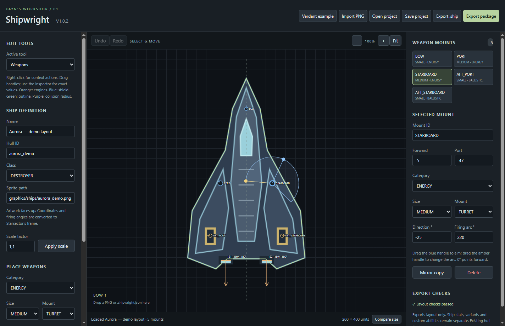
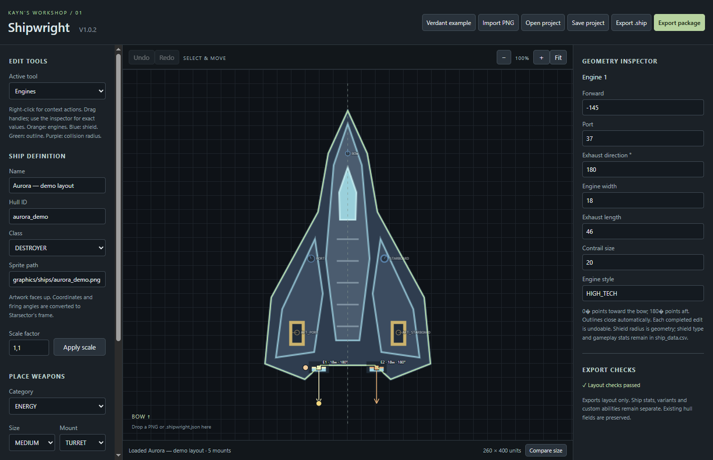
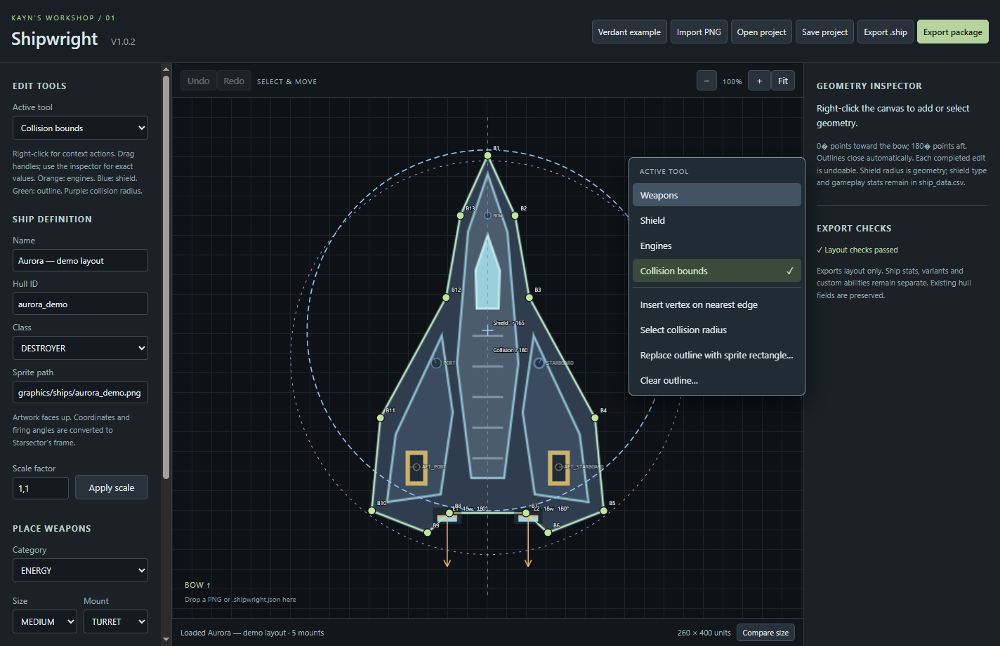

# Kayn Shipwright

Version **1.0.2**. Offline Electron/TypeScript Starsector hull-layout editor for Windows.

Import a ship sprite, arrange weapon mounts, edit engines/shields/collision geometry, and export an editable design package for integration into your mod.



**Weapon layout:** drag mounts and aiming/arc handles, or enter exact coordinates and properties in the inspector.

<details>
<summary>See engine editing and geometry tools</summary>



**Engines:** move an engine, adjust its exhaust and width using canvas handles, or edit its numeric settings.



**Geometry and tool switching:** edit collision vertices and shield geometry; right-click anywhere on the canvas to switch between Weapons, Shield, Engines and Collision bounds.

</details>

Screenshots show the actual Windows app with original demonstration artwork. The demo illustrates the editing workflow; it is not a game-verified ship or bundled game sprite.

## Features

Right-click anywhere on the canvas to choose **Weapons**, **Shield**, **Engines** or **Collision bounds**. The active tool is marked and its editing actions appear below. Tool switching does not add geometry. The sidebar selector stays synchronized.

- Weapon position, mount properties and aiming/arc handles.
- Engine add/duplicate/mirror/delete, position, width and exhaust direction/length handles, exact fields and style/contrail settings.
- Shield center and radius editing. Radius zero disables the editor circle; game shield type remains a ship stat.
- Closed collision polygon vertex editing, nearest-edge insertion, deletion, rectangle/clear actions and collision radius editing.
- Candidate validation, undo/redo, canceled-gesture restoration, revision-owned saving and generation-owned loading.
- Design export: editable project, `.ship`, sprite, labeled PNG preview, validation and SHA-256 manifest. Writes to its own staged folder, reads files back and publishes the complete folder under a unique name.

## Local setup

Use Node.js 26 or a compatible runtime supporting direct TypeScript test execution, plus npm. Dependency versions are pinned in `package-lock.json`.

```sh
npm ci
npm run assets:local -- "ABSOLUTE_PATH_TO_EXISTING_SHIPWRIGHT_ASSETS"
npm run build
npm start
```

The local game/reference sprite PNGs are deliberately excluded from Git. Supply your authorized local assets from an existing Shipwright installation/source folder. Six required files: `verdant.png`, `talon-reference.png`, `lasher-reference.png`, `hammerhead-reference.png`, `eagle-reference.png`, `onslaught-reference.png`. `assets/class-references.json` contains display dimensions and file names; `assets/verdant.ship` is the example layout fixture. Sprite redistribution rights are not granted by this source upload. Local sprite assets are required for the startup example and UI checks; class comparisons require their local reference images.

## Build and checks

```sh
npm run build
npm test
npm run test:ui
npm run test:geometry
npm run test:session
npm run test:package
npm run test:classes
npm run test:references
npm run test:regressions
npm run package
```

Run the geometry workflow before session/package checks because they use its generated fixture. Tests write ignored artifacts under `test-results/`. Packaging creates a portable Windows app under `release-v1.0.2/`. Generated bundles, dependencies, binaries, local PNG assets and test outputs are excluded from this source repository.

Test a specific packaged executable from PowerShell (no old release is selected implicitly):

```powershell
$env:SHIPWRIGHT_EXECUTABLE = (Resolve-Path 'release-v1.0.2/Kayn Shipwright-win32-x64/Kayn Shipwright.exe').Path
npm run test:packaged
npm run test:regressions
npm run test:geometry
Remove-Item Env:SHIPWRIGHT_EXECUTABLE
```

The packaged smoke test requires an absolute executable path and checks its running version against `package.json` (or an explicit `SHIPWRIGHT_EXPECTED_VERSION`). The regressions also support the selected executable; otherwise they launch the source build.

Saving or exporting completes an active drag before taking the snapshot. Escape, pointer cancellation, capture loss and tool switching cancel it without adding history. Undo completes then reverses the drag. Successful serialized saves record their exact revision even after undo. Native project/standalone hull saves write and read back an owned sibling temporary file before replacing the destination. Write/readback/replacement failure leaves the prior destination intact; cleanup failures are reported with the retained temporary location. This does not promise power-loss durability.

## Handoff workflow and limits

Save `.shipwright.json` for editing. Export the complete design folder for discussion and revisions; the preview supports visual review while the project preserves exact geometry and the manifest identifies artifacts. The package stages hull data for integration into an owning mod. Ship stats, variants, mod metadata, dependencies, balance and runtime verification remain separate. No active game files are written by export.

Nonempty bounds follow a conservative simple-polygon authoring policy; empty bounds remain supported as radius-only geometry. Screen/game coordinate conversion and class reference scale are independent of canvas zoom.

See [verification](docs/verification.md) for the checks performed and their limits. No license grant for third-party game artwork is implied. A source-code license has not yet been selected.
